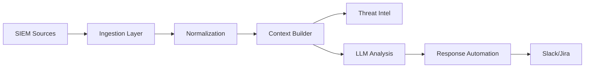

# AlertSentry-AI: AI-Powered SOC Alert Triage Assistant


**AI-powered SOC assistant that cuts alert triage time by 80%**

AlertSentry-AI automates the first-level triage of security alerts using Large Language Models. It ingests alerts from multiple SIEMs, classifies them, and provides actionable response recommendations.

[Run-as-Daemon](https://run-as-daemon.dev) | [GitHub Profile](https://github.com/ranas-mukminov)

## Features

- 🤖 **AI-Powered Analysis**: Uses GPT-4/Claude 3.5 to classify alerts with high accuracy.
- 🔌 **Multi-SIEM Support**: Integrates with Splunk, Elastic, Wazuh, and more.
- 🛡️ **Threat Intel Enrichment**: Automatically checks VirusTotal, AbuseIPDB, and OTX.
- ⚡ **Real-time Response**: Automates notifications to Slack, Jira, and Teams.
- 📊 **MITRE ATT&CK Mapping**: Maps alerts to relevant tactics and techniques.

## Quick Start

1. **Clone the repository**
   ```bash
   git clone https://github.com/ranas-mukminov/AlertSentry-AI.git
   cd AlertSentry-AI
   ```

2. **Configure environment**
   ```bash
   cp config/config.yaml config/local.yaml
   # Edit config/local.yaml with your API keys
   ```

3. **Run with Docker**
   ```bash
   cd docker
   docker-compose up -d
   ```

## Architecture



## Supported Integrations

| Category | Integration | Status |
|----------|-------------|--------|
| SIEM | Splunk | ✅ |
| SIEM | Elastic | ✅ |
| SIEM | Webhook | ✅ |
| AI | OpenAI | ✅ |
| AI | Anthropic | ✅ |
| Output | Slack | ✅ |
| Output | Jira | ✅ |

## Configuration

See `config/config.yaml` for full configuration options.

```yaml
alertsentry:
  llm:
    provider: "anthropic"
    model: "claude-3-5-sonnet-20241022"
```

## Enterprise Edition

Need more? Enterprise features include:
- ✅ Custom LLM fine-tuning on your data
- ✅ On-premise deployment
- ✅ SSO/SAML integration
- ✅ Advanced analytics dashboard
- ✅ Priority support with SLA
- ✅ Custom integrations

👉 Contact us: https://run-as-daemon.dev/enterprise

## Contributing

See [CONTRIBUTING.md](docs/CONTRIBUTING.md) for guidelines.

## License

MIT License. See [LICENSE](LICENSE) for details.

## Privacy & Compliance

This tool processes security alerts which may contain sensitive data.
- **Data Handling**: Alerts are sent to the configured LLM provider. Ensure this complies with your organization's data privacy policies.
- **Logging**: We log analysis results but do not store raw alerts permanently by default.
- **Compliance**: Designed to help meet SOC2 and ISO27001 monitoring requirements.
